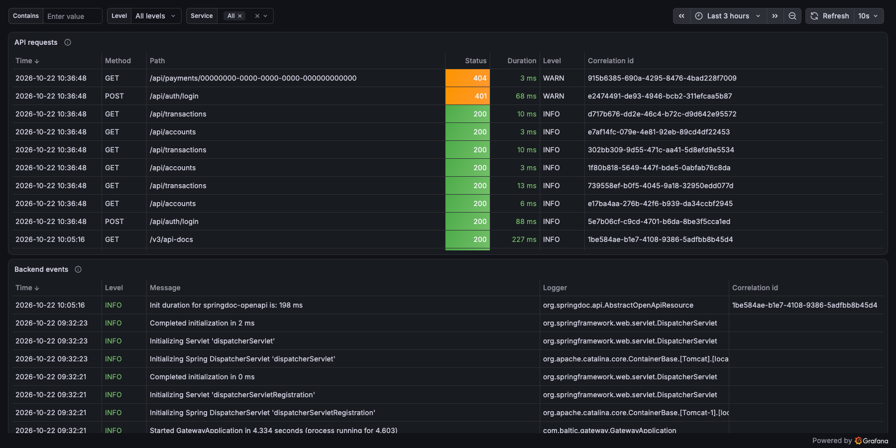

# Baltic Payments Mini-Gateway

A payment gateway in the way a bank does it: prepare a payment, review it with Verification of Payee, confirm it with a
simulated Smart-ID, get a receipt. Underneath are idempotent execution, pessimistic locking and an immutable
double-entry ledger, so a payment stays correct under concurrency, retries and a wrong beneficiary name.

<table>
  <tr>
    <td width="50%"></td>
    <td width="50%"></td>
  </tr>
  <tr>
    <td width="50%"></td>
    <td width="50%"></td>
  </tr>
</table>

## Getting started

Requires Docker.

```sh
docker compose up --build
docker compose down        # stop; add -v to delete the data
```

| Open | URL | Sign in |
|---|---|---|
| **Web app** | <http://localhost:4200> | `alice` / `Alice123!` or `bob` / `Bob12345!` |
| API docs (Swagger UI) | <http://localhost:8080/swagger-ui/index.html> | same users: `POST /api/auth/login`, then *Authorize* |
| Grafana metrics | <http://localhost:3000/d/baltic-gateway> | `admin` / `grafana-dev-only` |
| Grafana logs | <http://localhost:3000/d/baltic-logs> | same as above |
| Prometheus (metrics, alerts) | <http://localhost:9090> | none |
| PostgreSQL | `localhost:5432`, database `payments` | `payments` / `payments-dev-only` (owner), `payments_app` / `payments-app-dev-only` (application) |

**Try it:** sign in as `alice`, open Payments and pay Bob (`EE382200221020145685`). The name "Bob Tamm" matches, "Bob" is a
close match and "Mallory" is a mismatch that must be acknowledged. The simulated Smart-ID approves after a few seconds.

## Tech stack

| | |
|---|---|
| **Backend** | Java 25, Spring Boot 3.5, Spring Security (JWT), Spring Data JPA |
| **Frontend** | Angular 21, Angular Material, NgRx, served by nginx |
| **Database** | PostgreSQL 16, Liquibase migrations |
| **Infrastructure** | Docker Compose, nginx, Prometheus, Grafana, Loki, Alloy |
| **Quality** | JUnit, Mockito, ArchUnit, Testcontainers, Vitest, Playwright, JaCoCo, ESLint, Prettier |
| **CI** | GitHub Actions: build, all tests, coverage gates, E2E, CodeQL, Trivy image scan |

## Project structure

```text
baltic-payments-mini-gateway/
├── backend/            Spring Boot modular monolith
│   └── src/main/java/com/baltic/gateway/
│       ├── identity/       sign-in, users, login rate limiting
│       ├── accounts/       accounts, transfers, ledger, reconciliation
│       ├── payments/       payment flow, Verification of Payee, strong authentication
│       ├── transactions/   transaction history
│       ├── audit/          audit trail
│       └── platform/       money, errors, security, paging, metrics, rate limit
├── frontend/           Angular app
│   └── src/app/
│       ├── core/           auth service, guard, interceptor
│       ├── features/       login · accounts · payments · transactions
│       └── shared/         reusable UI and utilities
├── db/                 database role bootstrap
├── observability/      Prometheus rules, Loki and Alloy config, Grafana dashboards
├── docs/               screenshots
├── .github/workflows/  CI, CodeQL, image scan
└── docker-compose.yml
```

## Features

| | | |
|---|---|---|
| **Payments** | Flow | prepare → review → confirm with Smart-ID (simulated) → receipt |
| | Verification of Payee | `MATCH`, `CLOSE_MATCH`, `NO_MATCH`, `NOT_AVAILABLE`; a mismatch must be acknowledged |
| **Money correctness** | Concurrency | one transaction, locks in sorted IBAN order, idempotency key `payment-{id}` |
| | Ledger | immutable double-entry, scheduled reconciliation |
| | Amounts | `BigDecimal`, at most 12 integer digits and 2 decimals |
| **Security** | Access | JWT, ownership checks on every lookup, rate limiting |
| | Protection | audit trail, restricted database role, nginx security headers |
| **Operations** | Observability | Prometheus alerts, Grafana dashboards, Loki logs |
| **Quality** | Architecture | modular monolith checked by ArchUnit and ESLint |
| | Testing | unit, integration and E2E tests, coverage gates, CodeQL, Trivy |

## Payment flow


## Testing

```sh
cd backend && SPRING_PROFILES_ACTIVE=local ./mvnw verify   # JDK 25 and a running Docker daemon
```

Unit, ArchUnit architecture and PostgreSQL Testcontainers integration tests (concurrency, ledger immutability, seed
isolation); fails below 80% line coverage. On macOS: `JAVA_HOME=$(/usr/libexec/java_home -v 25) ./mvnw verify`.

```sh
cd frontend                       # Node 22 (>= 20.19); `nvm use` reads .nvmrc
npm ci
npm run lint && npm run format:check
npm run test:coverage             # Vitest with a coverage gate, report in frontend/coverage/
npx playwright install chromium
npm run e2e                       # isolated Compose project on ports 14200/18080
npm run e2e:ui                    # same, in Playwright UI Mode (or e2e:headed for a visible browser)
```

CI runs all of the above on every push and pull request.

## Monitoring

Grafana has a metrics dashboard and a logs dashboard (API requests, backend events); Prometheus has seven alert rules in
`observability/prometheus/alerts.yml` (no alert routing). Search the logs for the correlation id of an error response to
see everything that request logged.

<table>
  <tr>
    <td width="50%"></td>
    <td width="50%"></td>
  </tr>
</table>

## Security

Report vulnerabilities privately via GitHub's *Security → Report a vulnerability*. This is a demo, not a production bank.

| | |
|---|---|
| **JWT** | kept in `localStorage` and cannot be revoked; production would use OIDC with `httpOnly` refresh cookies |
| **Smart-ID** | simulated, verifies nothing; sign-in has no strong authentication, no limits, no fraud scoring |
| **Rate limits** | in memory, so per instance |
| **Dependencies** | two Spring Framework CVEs accepted in `.trivyignore.yaml` until 2026-12-31 (fix: Spring Boot 4); some patch versions pinned in `pom.xml` |
