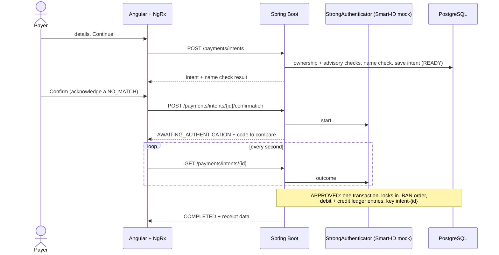

# Baltic Payments Mini-Gateway

A runnable payment-gateway assignment: Java 25, Spring Boot 3.5, PostgreSQL, Liquibase, Angular 21 (Material, NgRx) and
Docker Compose.

- **Payments** the way a bank does them: prepare, review (with **Verification of Payee**), confirm with a simulated
  **Smart-ID**, receipt. Underneath: idempotent execution, pessimistic locking and an immutable double-entry **ledger**.
- **Security**: JWT, ownership checks, login rate limiting, audit trail, hardened containers and nginx edge. See [SECURITY.md](SECURITY.md).
- **Quality gates**: unit, architecture (ArchUnit), Testcontainers integration and Playwright E2E tests; JaCoCo and Vitest
  coverage gates; ESLint/Prettier; CodeQL, Trivy and Dependabot.
- **Start reading at** [ADR 0004](docs/adr/0004-payment-intents-and-strong-authentication.md) (the payment flow),
  [ADR 0002](docs/adr/0002-money-ledger-payee-verification.md) and `PaymentExecutionService`: the interesting part is how a payment
  stays correct under concurrency, retries and a wrong beneficiary name.

### Five-minute tour

1. `docker compose up --build`, sign in as `alice` and make a payment (see *Run*).
2. Read the payment flow below, then `PaymentIntentService` → `IntentSettlementService` → `PaymentExecutionService` → `TransferService.transfer`.
3. Look at `PaymentConcurrencyTest` and `PaymentIntentIntegrationTest` for the guarantees (no double payment, no deadlock,
   no overdraft).
4. Look at `ArchitectureTest` and the ESLint boundary rules in `frontend/eslint.config.js` for the enforced structure.
5. Read *Known limitations* and *What I would do next* for what is deliberately left out.

### Payment flow



## Run

Requires Docker Desktop with Compose v2.

```sh
docker compose up --build
```

- App: <http://localhost:4200>
- API docs (only under the `local` profile, which Compose uses by default): <http://localhost:8080/swagger-ui/index.html>

The browser talks to the API only through nginx. Both the app and the backend port are published on `127.0.0.1` only (the
`local` profile ships a development JWT key and demo passwords), and Actuator runs on an internal management port (8081) used by the container health check.

To try a payment: sign in as `alice`, open **Payments**, pay Bob (`EE382200221020145685`, name "Bob Tamm"), press
**Continue**, check the review, press **Confirm with Smart-ID** and wait a few seconds: the simulated Smart-ID approves by
itself and the app opens the receipt. Try the name "Bob" (a close match, the registered name is shown) or "Mallory"
(a mismatch that must be acknowledged).

Demo accounts (seeded **only** under the `local` profile; all passwords are test-only):

| Username | Password | Accounts / holder |
|---|---|---|
| alice | Alice123! | 2 · Alice Kask |
| bob | Bob12345! | 2 · Bob Tamm |

There is only one kind of user: a customer, who sees and uses their own accounts and payments. Back-office access
(audit, ledger reconciliation) is deliberately not part of the customer application; see *Operations* below.

Stop with `docker compose down`; add `-v` to delete database data. The migration history is one baseline per module
until the first deployment, and the database provisions an unprivileged application role on first start, so an
existing local database must be reset once with `docker compose down -v`.

## Architecture

Modular monolith, package-by-feature, enforced by tests. Details and trade-offs are in
[ADR 0001](docs/adr/0001-modular-monolith.md) and [ADR 0002](docs/adr/0002-money-ledger-payee-verification.md).
The frontend layout is described in the next block and in ADR 0003.

```
backend/src/main/java/com/baltic/gateway
├─ platform/   money · error · web (error mapping, correlation id) · paging · openapi · ratelimit · security (JWT) · time · validation · metrics
├─ identity/   login, users, login rate limiter
├─ accounts/   accounts, ledger entries, transfers
├─ payments/   payment orchestration, idempotency, payee name check, transaction search
└─ audit/      append-only audit trail
   (each feature: api · application · domain · infrastructure; inside a layer, one folder per concept, e.g.
   accounts/application/{account,ledger,transfer}, payments/domain/{intent,transaction,payee} and
   identity/application/{login,strongauth}, api/<concept>/dto for request and response shapes; a feature with a single
   concept, like audit, stays flat)

backend/src/main/resources/db/changelog
├─ db.changelog-master.xml
├─ schema/     001-identity … 006-app-privileges    (plain SQL, one baseline per module; later changes are new files)
└─ seed/       001-demo-data.sql   (contexts local,test only)
```

The backend is a *layered* modular monolith, not hexagonal; see ADR 0001 for why.

```
frontend/src/app
├─ core/       auth service, guard, HTTP interceptor, session reset
├─ features/   login · accounts · payments · transactions
│  └─ <name>/  <name>.routes.ts (lazy) · pages/<page>/ (one folder per component: .ts .html .scss .spec.ts) · state/ (NgRx slice + API service)
└─ shared/     models, validators, utilities, ui/ (ui-page, ui-alert, ui-section-head, ui-empty-state, ui-status-pill, ui-stepper)
```

Features are lazy-loaded and register their own NgRx slice with their route. Imports use the `@core`, `@shared` and
`@features` aliases, and ESLint boundary rules (the frontend counterpart of the ArchUnit tests) forbid features from
depending on each other except through the public API of `accounts`. Rationale in
[ADR 0003](docs/adr/0003-frontend-structure-and-boundaries.md).

`shared/ui` holds the presentational building blocks (prefix `ui-`, OnPush, styled only with the semantic design
tokens in `styles.scss`). It is deliberately free of feature and NgRx imports so it can later be extracted into a
standalone library.

## Configuration and environments

| Setting | Meaning |
|---|---|
| `SPRING_PROFILES_ACTIVE` | `local` enables demo seed data, the API description (Swagger UI), a development JWT key and a development DB password. Any other profile requires `JWT_SECRET` and `DB_PASSWORD`. |
| `LIQUIBASE_CONTEXTS` | Defaults to `prod` (schema only). Demo data is tagged `local,test`. The `prod` context refuses to start when the database role `payments_app` does not exist. |
| `JWT_SECRET` | At least 32 bytes. |
| `STRONG_AUTH_MOCK_DELAY` | Compose variable for the simulated Smart-ID (`app.strong-auth.mock.delay`, default `PT3S`): how long it "waits" before approving. The simulator exists only when `app.strong-auth.mock.enabled=true` (the `local` profile). Any other profile starts, but payments cannot be confirmed (`503`) until a real authenticator is provided; see [ADR 0004](docs/adr/0004-payment-intents-and-strong-authentication.md). |
| `app.payments.*` | `intent-ttl` (10 min): how long a prepared payment may wait for the payer; `authentication-ttl` (2 min): how long the payer has to approve it. |
| `app.login-rate-limit.*` | Failed-login limits per window (default 15 minutes): `max-failures` 5 per IP + username, `max-failures-per-ip` 20, `max-failures-per-username` 20. |

## Tests

```sh
cd backend && SPRING_PROFILES_ACTIVE=local ./mvnw verify   # needs JDK 25 and a running Docker daemon
```

The Maven enforcer rejects older JDKs; on macOS select one with
`JAVA_HOME=$(/usr/libexec/java_home -v 25) ./mvnw verify`.

`verify` runs Mockito unit tests, ArchUnit architecture rules, PostgreSQL Testcontainers integration tests (including
concurrency, ledger immutability and seed isolation) and fails below 80% line coverage. The report is in
`backend/target/site/jacoco/`.

```sh
cd frontend                       # needs Node 22 (>= 20.19); `nvm use` reads .nvmrc
npm ci
npm run lint && npm run format:check
npm test                          # Angular unit-test builder with Vitest
npm run test:coverage             # same, with the coverage gate (report in frontend/coverage/)
npx playwright install chromium
npm run e2e                       # isolated Compose project "baltic-payments-e2e" on ports 14200/18080
```

CI (`.github/workflows/ci.yml`) runs all of the above plus container image builds with a Trivy scan; `codeql.yml`
adds static analysis.

## Design notes

- A payment is **prepared, confirmed and executed** in separate steps ([ADR 0004](docs/adr/0004-payment-intents-and-strong-authentication.md)):
  `POST /api/payments/intents` (checks the accounts and the beneficiary name, moves no money),
  `POST /api/payments/intents/{id}/confirmation` (starts the strong authentication and returns the code to compare),
  `GET /api/payments/intents/{id}` (polled; an approved payment is executed when it is read) and `DELETE` to cancel. There is
  no other way to pay. The details the payer reviewed cannot be changed afterwards, not even by the application's database
  role.
- Execution runs in one database transaction. Ownership of the source account is checked first, without a lock; then
  accounts are locked in sorted IBAN order, so opposite transfers cannot deadlock and overdrafts are impossible. Locks
  give up after 3 s (`409 Account busy`, the next poll tries again). A `CHECK (balance >= 0)` backs this up.
- Execution is idempotent: `(created_by, idempotency_key)` is unique and the key is derived from the intent id, so
  concurrent polls of an approved payment pay once and a retry replays the original result without taking any account lock.
- `GET /api/transactions` takes `q` (name, IBAN or reference), `from` (inclusive) and `to` (exclusive) as instants, so the
  client decides where a day starts in its own time zone. A user sees only the payments they made or received. The payments are selected in the database and paging counts rows as displayed: a transfer between a user's own
  accounts is two rows (debit and credit) and counts as two.
- Money is a `BigDecimal` on the server and a JSON number on the wire. A payment may have at most 12 integer digits and
  two decimals, so every amount is exact in a browser's `double`; see
  [ADR 0002](docs/adr/0002-money-ledger-payee-verification.md) for the reasoning and when to switch to strings.
- Every transfer writes a debit and a credit to `ledger_entries` with `balance_after`; the table is immutable. A
  reconciliation job (every 5 minutes, see *Operations*) proves that every transaction
  nets to zero, that each account's postings form an unbroken balance chain and that the latest posting equals the
  stored balance; discrepancies raise a metric and an alert. The ledger is a back-office record and has no customer
  endpoint: customers see their payments through `GET /api/transactions`.
- Verification of Payee: preparing a payment returns `MATCH`, `CLOSE_MATCH` (with the registered name), `NO_MATCH` or
  `NOT_AVAILABLE`, and the review shows it before anything is confirmed. A `NO_MATCH` payment can be confirmed only with an
  explicit acknowledgement (the UI asks for a tick box); the mismatch is stored on the transaction and in the audit log.
  Executing the payment recomputes the check, so a client cannot bypass it. Preparing payments is rate limited per user
  (20 per minute), because it is also a name check.
- In Docker Compose the application connects as `payments_app`, which cannot update, delete or truncate the ledger,
  the audit log or transactions; Liquibase migrates as the schema owner (`RestrictedDatabaseRoleIntegrationTest`).
- API errors use RFC 7807 `application/problem+json` with a stable machine-readable `code` (for example
  `INSUFFICIENT_FUNDS`, see `ErrorCode`), which is also the `reason` tag of rejected-payment metrics. A validated
  `X-Correlation-Id` is propagated to logs (MDC) and returned in the response.
- Liquibase owns the schema (plain SQL, one baseline file per module); Hibernate only validates it. Until the first
  deployment the history may be squashed; afterwards existing files must never be edited, only new ones added.

## Operations

The ledger reconciliation is an operations tool, not a customer feature, so it has no endpoint. It runs every five
minutes and publishes its result as metrics on the management port (8081), which is never published or proxied:
`ledger_reconciliation_discrepancies` (the total), `ledger_reconciliation_findings{check=...}` (one series per check:
`unbalanced_transactions`, `balance_mismatches`, `broken_balance_chains`) and `ledger_reconciliation_last_run_timestamp_seconds`.
A failing run is also logged as an error with the same counts.

```sh
docker compose exec backend curl -s http://localhost:8081/actuator/prometheus | grep ledger_reconciliation
```

The audit trail is written by the application and cannot be read through its API: it is kept in the append-only
`audit_log` table, which operations staff read with a database tool or, in a real bank, which a log pipeline would ship
to a SIEM. Customers only ever see their own data.

## Monitoring (optional)

```sh
docker compose --profile observability up --build
```

| | URL | Notes |
|---|---|---|
| Grafana | <http://localhost:3000> (change with `GRAFANA_PORT`) | user `admin`, password `grafana-dev-only` (override with `GRAFANA_PASSWORD`); dashboard *Baltic Payments Gateway* is provisioned from code |
| Prometheus | <http://localhost:9090> | seven alert rules in `observability/prometheus/alerts.yml` |

Both are bound to `127.0.0.1`. The application exposes metrics on the internal management port (`backend:8081/actuator/prometheus`),
which is not published and not proxied by nginx; a test asserts that the public port does not serve it.

Business metrics (all with bounded tag values): `payments_total{outcome,currency,reason}` (completed, replayed, rejected with
reason), `payments_value_total`, `payments_processing_seconds` (histogram), `auth_logins_total{outcome}` (success, failed,
blocked), plus the standard HTTP, JVM and connection-pool metrics. The dashboard has panels for throughput, latency
percentiles, rejection reasons, sign-in outcomes, HTTP status, JVM heap and the database pool, and a ledger
reconciliation status next to the payment counters. `payments_value_total` is exported but not charted: a counter
cannot give an exact amount for a time window (`increase()` extrapolates), so exact amounts come from the ledger.

Alerts: gateway down, payment rejection rate above 30%, a burst of failed or blocked sign-ins, payment p95 above one second,
any 5xx responses, a ledger discrepancy (`ledger_reconciliation_discrepancies`) and a stale reconciliation job. Series start
at zero on boot so `increase()` and `rate()` see the first event. Alert routing (email, Slack) is intentionally not configured.

## Known limitations

This is an educational mini-gateway, not a production banking system. Left out on purpose, with what a real bank would do:

- **Back-office roles.** Auditors, compliance and operations staff use internal tools with single sign-on, need-to-know
  access and logged queries, never the customer application. Here the reconciliation result is a metric on the internal management port and
  the audit log is a table.
- **Ledger.** The ledger is double-entry per transfer between customer accounts. A bank also has internal accounts (settlement,
  fees), a chart of accounts, period closing and reversal postings that correct a mistake without editing history; opening
  balances would be postings too (the demo seed loads them directly).
- **Smart-ID.** Payment confirmation is simulated behind an interface; a real provider is an adapter. The simulator
  approves every request after a delay and verifies nothing.
- **A read that executes a payment.** `GET /api/payments/intents/{id}` executes an approved payment, because the
  provider's outcome is polled rather than pushed. Concurrent polls pay once (the key derives from the intent id) and the
  response is not cacheable, but a plain `GET` should be safe: with a provider callback or a background poller the read
  would become side-effect free (see *What I would do next*).
- **Access tokens.** A JWT is valid until it expires (60 minutes) even if the user is disabled meanwhile; there is no
  logout, `jti` or revocation list, and the filter does not query the database.
- **Payee name check.** A `CLOSE_MATCH` returns the registered holder name, as Verification of Payee does; guessing is
  limited by the per-user rate limit (20 per minute), not prevented.
- **Single instance.** Rate limits are in memory per instance, and the reconciliation job runs on every instance without
  a distributed lock.
- **Local profile by default.** Compose starts the `local` profile (demo data, Swagger UI, development secrets, simulated
  Smart-ID) and publishes ports on `127.0.0.1` only; it is a demo setup, not a production one.
- **Not implemented:** strong authentication at sign-in, transaction limits, OIDC/refresh tokens, key rotation, external
  payment rails and distributed rate limiting. Several are explained in [SECURITY.md](SECURITY.md).

## What I would do next

1. **A real Smart-ID/Mobile-ID adapter** (the provider's demo environment) with a callback instead of polling, so an
   approval is executed even when the browser is closed (ADR 0004, *Consequences*).
2. **Amounts as strings on the wire** (`"123.50"`, as in Berlin Group APIs) instead of JSON numbers (ADR 0002).
3. **Spring Boot 4**, which removes the two accepted Spring Framework advisories listed in `.trivyignore.yaml`.
4. **Statement from ledger entries.** The transaction history could be read from `ledger_entries` joined to the caller's
   accounts, which gives a debit row and a credit row per own-account transfer straight from the database and avoids the
   in-memory paging in `TransactionHistoryService`.
5. **Shared rate limiting and token revocation** (Redis or the gateway) once there is more than one instance.

Dependabot runs monthly (at most two pull requests per ecosystem). Major upgrades (Spring Boot 4 with springdoc 3,
Angular 22 with TypeScript 6 and angular-eslint 22, newer JDK/Node lines) are excluded on purpose: each is one planned
migration, not a bot bump (see `.github/dependabot.yml`).
