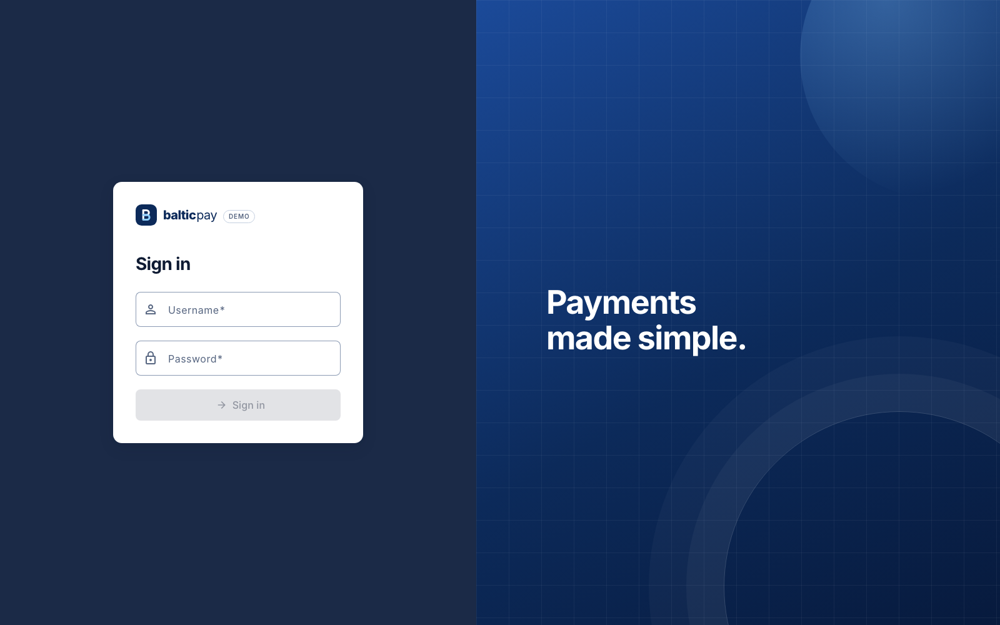
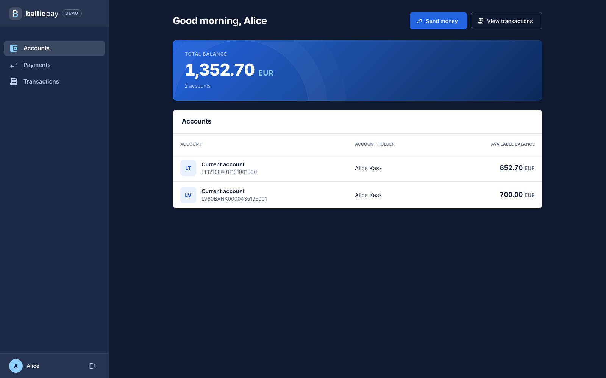
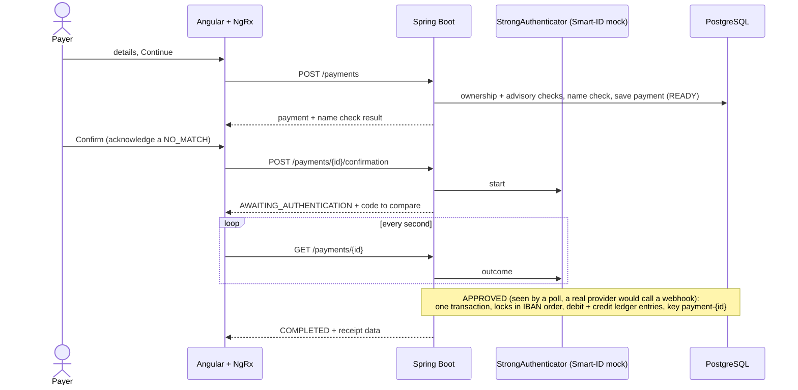
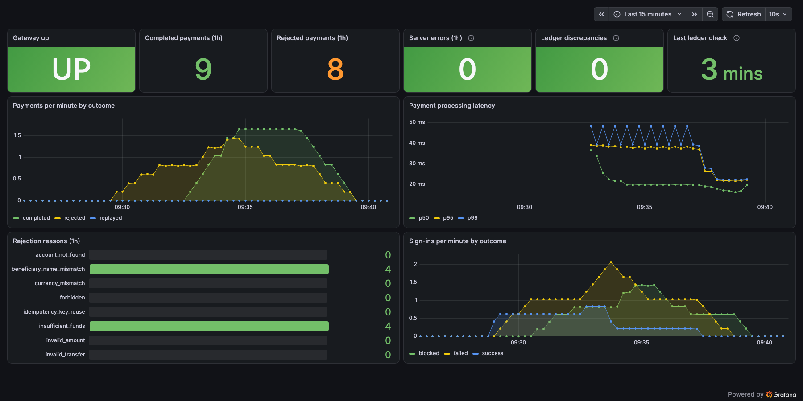

# Baltic Payments Mini-Gateway

A payment gateway in the way a bank does it: prepare a payment, review it with Verification of Payee, confirm it with a
simulated Smart-ID, get a receipt. Underneath are idempotent execution, pessimistic locking and an immutable
double-entry ledger, so a payment stays correct under concurrency, retries and a wrong beneficiary name.

<table>
  <tr>
    <td width="50%"></td>
    <td width="50%"></td>
  </tr>
  <tr>
    <td width="50%"></td>
    <td width="50%"></td>
  </tr>
</table>

## Getting started

```sh
docker compose up --build
docker compose down        # stop; add -v to delete the data
```

<table>
  <tr><td><b>Web app</b></td><td><a href="http://localhost:4200">localhost:4200</a></td><td><code>alice</code> / <code>Alice123!</code> or <code>bob</code> / <code>Bob12345!</code></td></tr>
  <tr><td>API docs (Swagger UI)</td><td><a href="http://localhost:8080/swagger-ui/index.html">localhost:8080/swagger-ui</a></td><td>same users: <code>POST /api/auth/login</code>, then <i>Authorize</i></td></tr>
  <tr><td>Grafana metrics</td><td><a href="http://localhost:3000/d/baltic-gateway">localhost:3000/d/baltic-gateway</a></td><td><code>admin</code> / <code>grafana-dev-only</code></td></tr>
  <tr><td>Grafana logs</td><td><a href="http://localhost:3000/d/baltic-logs">localhost:3000/d/baltic-logs</a></td><td><code>admin</code> / <code>grafana-dev-only</code></td></tr>
  <tr><td>Prometheus alerts</td><td><a href="http://localhost:9090/alerts">localhost:9090/alerts</a></td><td>none</td></tr>
  <tr><td>PostgreSQL</td><td><code>localhost:5432</code>, database <code>payments</code></td><td><code>payments</code> / <code>payments-dev-only</code></td></tr>
</table>

**Try it:** sign in as `alice`, open Payments and pay Bob (`EE382200221020145685`). The name "Bob Tamm" matches, "Bob" is a
close match and "Mallory" is a mismatch that must be acknowledged. The simulated Smart-ID approves after a few seconds.

## Tech stack

<table>
  <tr><td><b>Backend</b></td><td>Java 25, Spring Boot 3.5, Spring Security (JWT), Spring Data JPA</td></tr>
  <tr><td><b>Frontend</b></td><td>Angular 21, Angular Material, NgRx, served by nginx</td></tr>
  <tr><td><b>Database</b></td><td>PostgreSQL 16, Liquibase migrations</td></tr>
  <tr><td><b>Infrastructure</b></td><td>Docker Compose, nginx, Prometheus, Grafana, Loki, Alloy</td></tr>
  <tr><td><b>Quality</b></td><td>JUnit, Mockito, ArchUnit, Testcontainers, Vitest, Playwright, JaCoCo, ESLint, Prettier</td></tr>
  <tr><td><b>CI</b></td><td>GitHub Actions: build, all tests, coverage gates, E2E, CodeQL, Trivy image scan</td></tr>
</table>

## Project structure

```text
baltic-payments-mini-gateway/
├── backend/            Spring Boot modular monolith
│   └── src/main/java/com/baltic/gateway/
│       ├── identity/       sign-in, users, login rate limiting
│       ├── accounts/       accounts, transfers, ledger, reconciliation
│       ├── payments/       payment flow, Verification of Payee, strong authentication
│       ├── transactions/   transaction history
│       ├── audit/          audit trail
│       └── platform/       money, errors, security, paging, metrics, rate limit
├── frontend/           Angular app
│   └── src/app/
│       ├── core/           auth service, guard, interceptor
│       ├── features/       login · accounts · payments · transactions
│       └── shared/         reusable UI and utilities
├── db/                 database role bootstrap
├── observability/      Prometheus rules, Loki and Alloy config, Grafana dashboards
├── screenshots/        images used in this README
├── .github/workflows/  CI, CodeQL, image scan
└── docker-compose.yml
```

## Features

<table>
  <tr><td rowspan="2"><b>Payments</b></td><td>Flow</td><td>prepare → review → confirm with Smart-ID (simulated) → receipt</td></tr>
  <tr><td>Verification of Payee</td><td><code>MATCH</code>, <code>CLOSE_MATCH</code>, <code>NO_MATCH</code>, <code>NOT_AVAILABLE</code>; a mismatch must be acknowledged</td></tr>
  <tr><td rowspan="2"><b>Money correctness</b></td><td>Execution</td><td>one transaction, locks in sorted IBAN order, idempotency key <code>payment-{id}</code>, <code>BigDecimal</code> amounts</td></tr>
  <tr><td>Ledger</td><td>immutable double-entry, scheduled reconciliation</td></tr>
  <tr><td rowspan="2"><b>Security</b></td><td>Access</td><td>JWT, ownership checks on every lookup, rate limiting</td></tr>
  <tr><td>Protection</td><td>audit trail, restricted database role, nginx security headers</td></tr>
  <tr><td rowspan="2"><b>Operations</b></td><td>Observability</td><td>Prometheus alerts, Grafana dashboards, Loki logs</td></tr>
  <tr><td>CI</td><td>GitHub Actions, CodeQL, Trivy image scan, Dependabot</td></tr>
  <tr><td rowspan="2"><b>Quality</b></td><td>Architecture</td><td>modular monolith checked by ArchUnit and ESLint</td></tr>
  <tr><td>Testing</td><td>unit, integration and E2E tests, coverage gates</td></tr>
</table>

## Payment flow



## Testing

```sh
cd backend
SPRING_PROFILES_ACTIVE=local ./mvnw verify   # JDK 25, Docker running

cd ../frontend                               # Node 22+
npm ci
npm run lint && npm run format:check && npm run test:coverage
npx playwright install chromium && npm run e2e
```

CI runs all of this on every push and pull request.

## Monitoring

Prometheus scrapes the backend and evaluates seven alert rules: gateway down, high payment rejection rate, suspected
brute force, slow payments, server errors, ledger discrepancy and stale ledger reconciliation. Alerts are not routed
anywhere.

Grafana has two dashboards:
- **Metrics:** payments per minute by outcome, rejection reasons, processing latency, sign-ins, server errors and the
  ledger check status.
- **Logs:** API requests and backend events from Loki. Search for the correlation id of an error response to see
  everything that request logged.

<table>
  <tr>
    <td width="50%"></td>
    <td width="50%"></td>
  </tr>
</table>

## Limitations

Demo scope: Smart-ID is simulated, the JWT lives in `localStorage` and cannot be revoked, and rate limits are in memory
(per instance).
