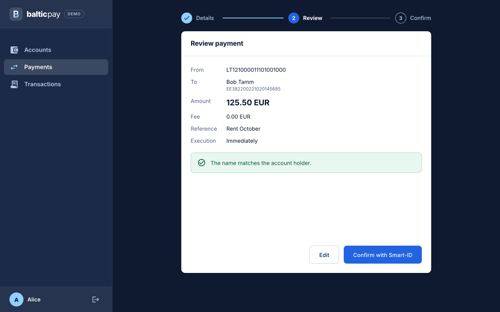
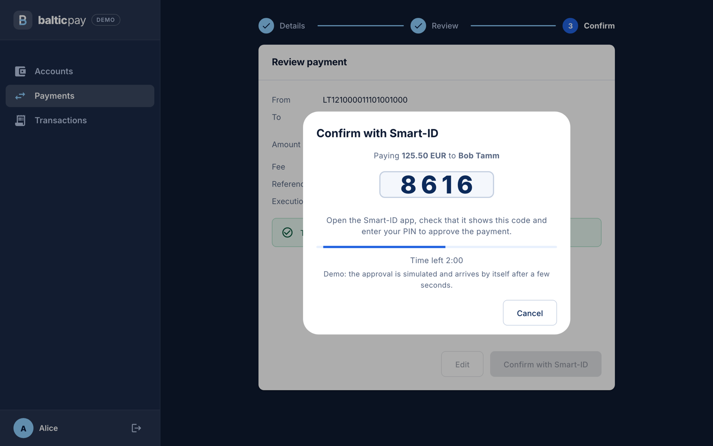

# Baltic Payments Mini-Gateway

A payment gateway in the way a bank does it: prepare a payment, review it with **Verification of Payee**, confirm it with a
simulated **Smart-ID**, get a receipt. Underneath are idempotent execution, pessimistic locking and an immutable
double-entry ledger, so a payment stays correct under concurrency, retries and a wrong beneficiary name.


## Features

- Accounts and balances, payments between accounts, searchable transaction history
- Payment intents: details → review → Smart-ID confirmation → receipt
- Verification of Payee (`MATCH`, `CLOSE_MATCH`, `NO_MATCH`, `NOT_AVAILABLE`) with explicit acknowledgement of a mismatch
- No double payment, no deadlock, no overdraft; an immutable ledger with scheduled reconciliation
- JWT sign-in, ownership checks, rate limiting, audit trail, restricted database role
- Metrics, Prometheus alerts and a Grafana dashboard

## Payment flow

| Review with Verification of Payee | Smart-ID confirmation |
|---|---|
|  |  |

## Tech stack

| | |
|---|---|
| Backend | Java 25, Spring Boot 3.5, Spring Security (JWT), Spring Data JPA, Liquibase |
| Frontend | Angular 21, Angular Material, NgRx |
| Database | PostgreSQL 16 |
| Infrastructure | Docker Compose, nginx, Prometheus, Grafana |
| Quality | JUnit, Mockito, ArchUnit, Testcontainers, Vitest, Playwright, JaCoCo, ESLint, Prettier, CodeQL, Trivy |

## Project structure

```
├─ backend/        Spring Boot modular monolith: identity · accounts · payments · audit · platform
├─ frontend/       Angular app: core · features (login, accounts, payments, transactions) · shared
├─ db/             database role bootstrap
├─ observability/  Prometheus rules and Grafana dashboards
├─ docs/           architecture, operations, limitations and ADRs
└─ docker-compose.yml
```

## Getting started

Requires Docker Desktop with Compose v2.

```sh
docker compose up --build
```

- App: <http://localhost:4200>
- API docs: <http://localhost:8080/swagger-ui/index.html> (`local` profile, the Compose default)
- Monitoring: `docker compose --profile observability up --build` ([details](docs/operations.md#monitoring-optional))

Sign in as `alice` / `Alice123!` (or `bob` / `Bob12345!`; demo data is seeded only under the `local` profile), open
**Payments** and pay Bob (`EE382200221020145685`, name "Bob Tamm"). Try the name "Bob" (a close match) or "Mallory" (a
mismatch that must be acknowledged). The simulated Smart-ID approves by itself after a few seconds.

Stop with `docker compose down`; add `-v` to delete the database data.

## Testing

```sh
cd backend && SPRING_PROFILES_ACTIVE=local ./mvnw verify   # JDK 25 and a running Docker daemon
```

Unit, ArchUnit architecture and PostgreSQL Testcontainers integration tests (concurrency, ledger immutability, seed
isolation); fails below 80% line coverage. On macOS: `JAVA_HOME=$(/usr/libexec/java_home -v 25) ./mvnw verify`.

```sh
cd frontend                       # Node 22 (>= 20.19); `nvm use` reads .nvmrc
npm ci
npm run lint && npm run format:check
npm run test:coverage             # Vitest with a coverage gate, report in frontend/coverage/
npx playwright install chromium
npm run e2e                       # isolated Compose project on ports 14200/18080
```

CI (`.github/workflows/ci.yml`) runs all of the above plus container image builds with a Trivy scan; `codeql.yml` adds
static analysis.

## Documentation

| | |
|---|---|
| [Architecture](docs/architecture.md) | Module layout, payment flow, concurrency, ledger and design notes |
| [Operations](docs/operations.md) | Configuration, reconciliation, audit trail, monitoring and alerts |
| [Limitations](docs/limitations.md) | What is left out on purpose and what comes next |
| [ADRs](docs/adr) | Modular monolith, money and ledger, frontend boundaries, payment intents and strong authentication |
| [SECURITY.md](SECURITY.md) | Security controls and vulnerability reporting |
| [AGENTS.md](AGENTS.md) | Conventions for AI coding assistants |

Start reading at [ADR 0004](docs/adr/0004-payment-intents-and-strong-authentication.md) and `PaymentExecutionService`.
