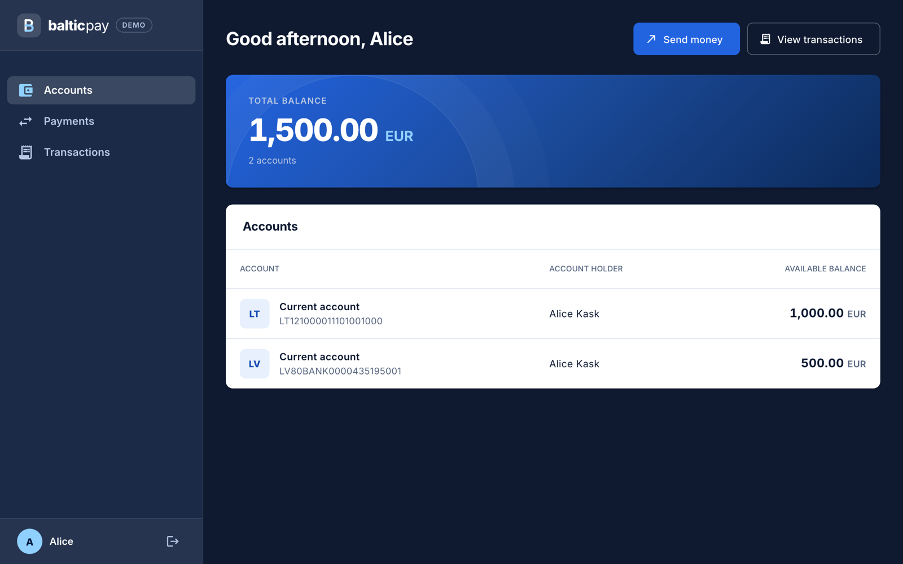
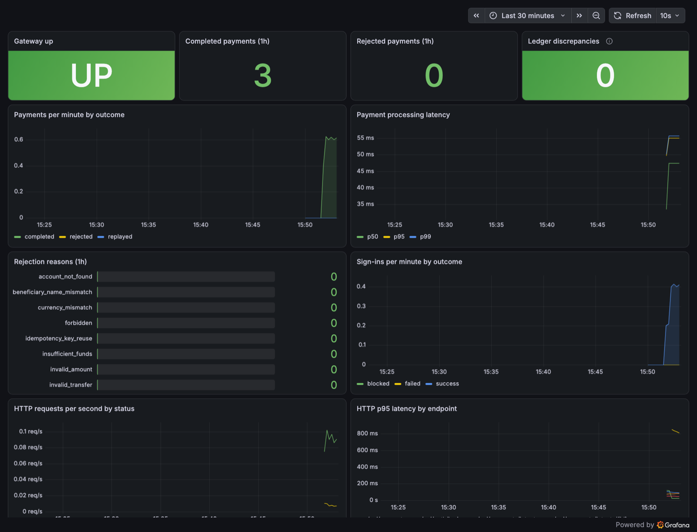

# Baltic Payments Mini-Gateway

A payment gateway in the way a bank does it: prepare a payment, review it with **Verification of Payee**, confirm it with a
simulated **Smart-ID**, get a receipt. Underneath are idempotent execution, pessimistic locking and an immutable
double-entry ledger, so a payment stays correct under concurrency, retries and a wrong beneficiary name.



## Tech stack

| Layer | Technology |
|---|---|
| Backend | Java 25, Spring Boot 3.5, Spring Security (JWT), Spring Data JPA, Liquibase |
| Frontend | Angular 21, Angular Material, NgRx |
| Database | PostgreSQL 16 |
| Infrastructure | Docker Compose, nginx, Prometheus, Grafana |
| Quality | JUnit, Mockito, ArchUnit, Testcontainers, Vitest, Playwright, JaCoCo, ESLint, Prettier, CodeQL, Trivy |
| CI | GitHub Actions: build, all tests, coverage gates, E2E, image scan, static analysis |

## Features

**Payments**
- Accounts and balances, payments between accounts, searchable transaction history
- Guided flow: details → review → Smart-ID confirmation → receipt
- **Verification of Payee** (`MATCH`, `CLOSE_MATCH`, `NO_MATCH`, `NOT_AVAILABLE`); a mismatch must be acknowledged explicitly
- Simulated **Smart-ID** strong authentication behind a `StrongAuthenticator` port

**Money correctness**
- No double payment: idempotent execution through `(created_by, idempotency_key)`
- No deadlock: account locks always taken in sorted IBAN order, one transaction per payment
- No overdraft: balance checked under lock
- Immutable double-entry ledger with scheduled reconciliation; `BigDecimal` amounts, never `double`

**Security**
- JWT sign-in, ownership checks on every lookup, rate limiting
- Audit trail; the application database role has no update or delete on ledger, audit and transactions
- Security headers in nginx, RFC 7807 errors with stable error codes

**Engineering quality**
- Modular monolith with package boundaries enforced by ArchUnit; frontend boundaries enforced by ESLint
- Unit, architecture, Testcontainers integration (concurrency, ledger immutability) and Playwright E2E tests
- Coverage gates: backend above 80% line coverage (JaCoCo), frontend thresholds in `angular.json`
- Liquibase migrations, versioned and never edited after deployment; ADRs for the key decisions

**CI/CD (GitHub Actions)**
- `ci.yml` on every push and pull request: backend `verify` (unit, architecture, integration, coverage), frontend lint,
  format check, unit tests with coverage and production build, then Playwright E2E against the full Compose stack
- Backend and frontend container images are built and scanned with Trivy (HIGH/CRITICAL with a fix), also weekly
  through `image-scan.yml`
- `codeql.yml`: CodeQL static analysis on every push and pull request, also weekly
- Dependabot keeps dependencies current; coverage and E2E diagnostics are kept as build artifacts

**Observability**
- Metrics, Prometheus alerts and a Grafana dashboard, started together with the stack

## Payment flow


More in [docs/architecture.md](docs/architecture.md): locking, idempotency, ledger and design notes.

## Project structure

```text
baltic-payments-mini-gateway/
├── backend/            Spring Boot modular monolith
│   └── src/main/java/com/baltic/gateway/
│       ├── identity/       sign-in, users, login rate limiting
│       ├── accounts/       accounts, transfers, ledger, reconciliation
│       ├── payments/       payment flow, Verification of Payee, strong authentication
│       ├── transactions/   transaction history
│       ├── audit/          audit trail
│       └── platform/       money, errors, security, paging, metrics, rate limit
├── frontend/           Angular app
│   └── src/app/
│       ├── core/           auth service, guard, interceptor
│       ├── features/       login · accounts · payments · transactions
│       └── shared/         reusable UI and utilities
├── db/                 database role bootstrap
├── observability/      Prometheus rules, Grafana dashboards
├── docs/               architecture, operations, limitations, ADRs
├── .github/workflows/  CI, CodeQL, image scan
└── docker-compose.yml
```

## Getting started

Requires Docker Desktop with Compose v2.

```sh
docker compose up --build
```

- App: <http://localhost:4200>
- API docs: <http://localhost:8080/swagger-ui/index.html> (`local` profile, the Compose default)
- Grafana: <http://localhost:3000>, Prometheus: <http://localhost:9090> ([Monitoring](#monitoring))

The default Compose stack serves the production-built frontend through nginx, including the configured security headers.
For live frontend source updates, run `docker compose --profile dev up --build db backend frontend-dev` instead.

Demo accounts (seeded only under the `local` profile, passwords are test-only):

| Username | Password | Accounts | Holder |
|---|---|---|---|
| `alice` | `Alice123!` | 2 | Alice Kask |
| `bob` | `Bob12345!` | 2 | Bob Tamm |

Sign in as `alice`, open **Payments** and pay Bob (`EE382200221020145685`, name "Bob Tamm"). Try the name "Bob" (a close
match) or "Mallory" (a mismatch that must be acknowledged). The simulated Smart-ID approves by itself after a few
seconds. There is one kind of user, a customer; back-office access (audit, reconciliation) is deliberately not part of the
application ([operations](docs/operations.md)).

Stop with `docker compose down`; add `-v` to delete the database data.

## Monitoring

Prometheus and Grafana start with the stack: Grafana at <http://localhost:3000> (`admin` / `grafana-dev-only`, dashboard
**Baltic Payments Gateway**), Prometheus at <http://localhost:9090>. Metrics, alerts and ports:
[docs/operations.md](docs/operations.md#monitoring).



## Testing

```sh
cd backend && SPRING_PROFILES_ACTIVE=local ./mvnw verify   # JDK 25 and a running Docker daemon
```

Unit, ArchUnit architecture and PostgreSQL Testcontainers integration tests (concurrency, ledger immutability, seed
isolation); fails below 80% line coverage. On macOS: `JAVA_HOME=$(/usr/libexec/java_home -v 25) ./mvnw verify`.

```sh
cd frontend                       # Node 22 (>= 20.19); `nvm use` reads .nvmrc
npm ci
npm run lint && npm run format:check
npm run test:coverage             # Vitest with a coverage gate, report in frontend/coverage/
npx playwright install chromium
npm run e2e                       # isolated Compose project on ports 14200/18080
```

CI runs all of the above on every push and pull request, see [CI/CD](#features).

## Documentation

| Document | Contents |
|---|---|
| [Architecture](docs/architecture.md) | Module layout, payment flow, concurrency, ledger and design notes |
| [Operations](docs/operations.md) | Configuration, reconciliation, audit trail, monitoring and alerts |
| [Limitations](docs/limitations.md) | What is left out on purpose and what comes next |
| [ADRs](docs/adr) | Modular monolith, money and ledger, frontend boundaries, payments and strong authentication |
| [SECURITY.md](SECURITY.md) | Security controls and vulnerability reporting |
| [AGENTS.md](AGENTS.md) | Conventions for AI coding assistants |

Start reading at [ADR 0004](docs/adr/0004-payments-and-strong-authentication.md) and `PaymentExecutionService`.
