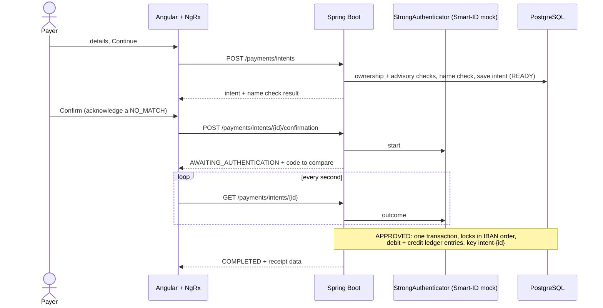

# Architecture

Modular monolith, package-by-feature, enforced by tests (`ArchitectureTest` on the backend, ESLint boundary rules on the
frontend). Rationale and trade-offs: [ADR 0001](adr/0001-modular-monolith.md),
[ADR 0002](adr/0002-money-ledger-payee-verification.md), [ADR 0003](adr/0003-frontend-structure-and-boundaries.md) and
[ADR 0004](adr/0004-payment-intents-and-strong-authentication.md).

## Backend

```
backend/src/main/java/com/baltic/gateway
├─ platform/   money · error · web · paging · openapi · ratelimit · security (JWT) · time · validation · metrics
├─ identity/   login, users, login rate limiter, strong authentication port
├─ accounts/   accounts, ledger entries, transfers, ledger reconciliation
├─ payments/   payment intents, execution, idempotency, payee name check, transaction search
└─ audit/      append-only audit trail
```

Each feature has the layers `api`, `application`, `domain` and `infrastructure`; inside a layer there is one folder per
concept (for example `accounts/application/{account,ledger,transfer}`) and request/response shapes live in
`api/<concept>/dto`. A feature with a single concept, like `audit`, stays flat. The backend is a layered modular
monolith, not hexagonal (ADR 0001).

```
backend/src/main/resources/db/changelog
├─ db.changelog-master.xml
├─ schema/     001-identity … 006-app-privileges   (plain SQL, one baseline per module; later changes are new files)
└─ seed/       001-demo-data.sql                   (contexts local,test only)
```

## Frontend

```
frontend/src/app
├─ core/       auth service, guard, HTTP interceptor, session reset
├─ features/   login · accounts · payments · transactions
│  └─ <name>/  <name>.routes.ts (lazy) · pages/<page>/ · state/ (NgRx slice + API service)
└─ shared/     models, validators, utilities, ui/ (presentational building blocks)
```

Features are lazy-loaded and register their own NgRx slice with their route. Imports use the `@core`, `@shared` and
`@features` aliases; features may depend on each other only through the public API of `accounts`. `shared/ui` is free of
feature and NgRx imports so it can be extracted into a library later.

## Payment flow



Read in this order: `PaymentIntentService` → `PaymentConfirmationService` → `PaymentExecutionService` →
`TransferService.transfer`.

## Design notes

- **Prepare, confirm, execute.** `POST /api/payments/intents` checks the accounts and the beneficiary name and moves no
  money; `POST /api/payments/intents/{id}/confirmation` starts the strong authentication and returns the code to compare;
  `GET /api/payments/intents/{id}` is polled and executes an approved payment; `DELETE` cancels. There is no other way to
  pay. The reviewed details cannot be changed afterwards, not even by the application's database role.
- **Concurrency.** Execution runs in one database transaction. Ownership of the source account is checked first, without
  a lock; then accounts are locked in sorted IBAN order, so opposite transfers cannot deadlock and overdrafts are
  impossible. Locks give up after 3 s (`409 Account busy`, the next poll tries again). `CHECK (balance >= 0)` backs this up.
- **Idempotency.** `(created_by, idempotency_key)` is unique and the key derives from the intent id, so concurrent polls of
  an approved payment pay once and a retry replays the original result without taking any account lock.
- **Ledger.** Every transfer writes a debit and a credit to `ledger_entries` with `balance_after`; the table is immutable.
  A reconciliation job proves that every transaction nets to zero, that each account's postings form an unbroken balance
  chain and that the latest posting equals the stored balance. The ledger is a back-office record with no customer endpoint.
- **Verification of Payee.** Preparing a payment returns `MATCH`, `CLOSE_MATCH` (with the registered name), `NO_MATCH` or
  `NOT_AVAILABLE`. A `NO_MATCH` payment can be confirmed only with an explicit acknowledgement, which is stored on the
  transaction and in the audit log. Execution recomputes the check, so a client cannot bypass it. Preparing payments is
  rate limited per user (20 per minute) because it doubles as a name check.
- **Transaction search.** `GET /api/transactions` takes `q` (name, IBAN or reference), `from` (inclusive) and `to`
  (exclusive) as instants, so the client decides where a day starts in its own time zone. A user sees only payments they
  made or received. Paging counts rows as displayed: a transfer between a user's own accounts is two rows.
- **Money.** `BigDecimal` on the server and a JSON number on the wire, with at most 12 integer digits and two decimals, so
  every amount is exact in a browser's `double` (ADR 0002).
- **Database role.** The application connects as `payments_app`, which cannot update, delete or truncate the ledger, the
  audit log or transactions; Liquibase migrates as the schema owner (`RestrictedDatabaseRoleIntegrationTest`).
- **Errors.** RFC 7807 `application/problem+json` with a stable `code` (see `ErrorCode`), which is also the `reason` tag of
  rejected-payment metrics. A validated `X-Correlation-Id` is propagated to logs (MDC) and returned in the response.
- **Schema.** Liquibase owns the schema (plain SQL, one baseline per module); Hibernate only validates it. Until the first
  deployment the history may be squashed; afterwards existing files are never edited, only new ones added.
